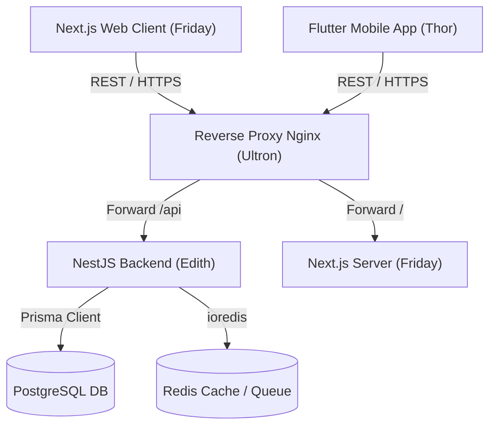

# 02 — System Architecture

> Maintained by `iron_man` and `edith`.

---

## 1. High-Level Architecture
The system follows a modular client-server architecture with strict API contracts and optional mobile support:

---

## 2. Component Boundaries
- **Frontend Layer**: Next.js App Router (React Server & Client Components).
- **Mobile Layer (Optional)**: Flutter (Dart) with clean architecture.
- **Backend Layer**: NestJS Modular Monolith with Domain-Driven Design (Controllers, Services, Repositories).
- **Data Layer**: PostgreSQL 15+ managed via Prisma ORM.
- **Caching & Queue**: Redis for session caching, rate limiting, and background jobs.
